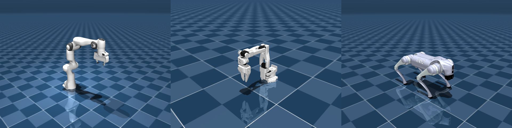
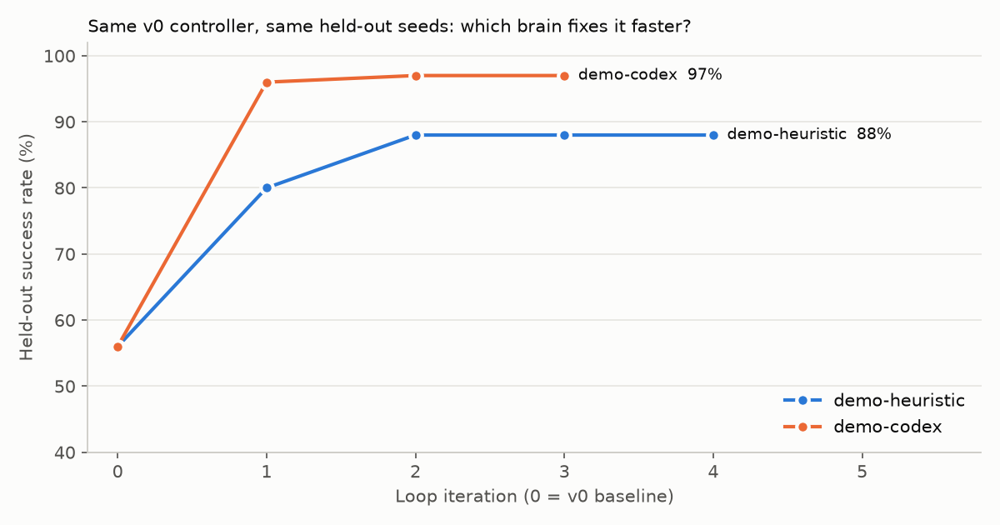
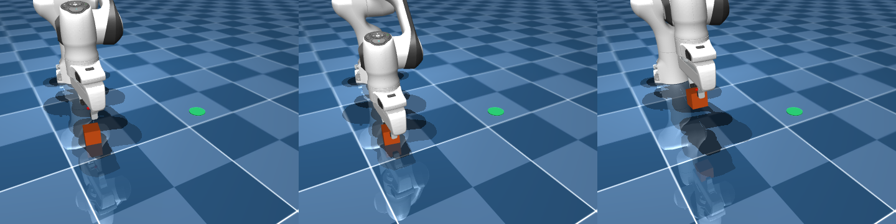
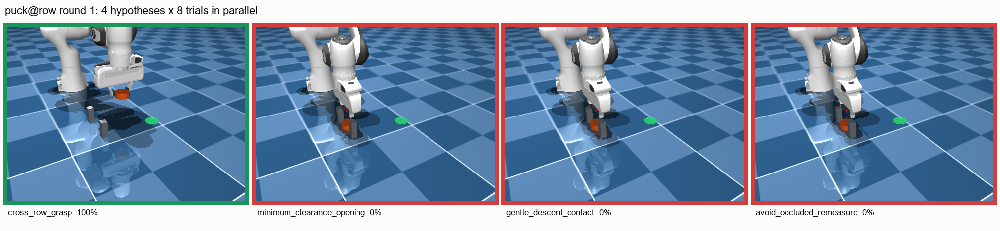
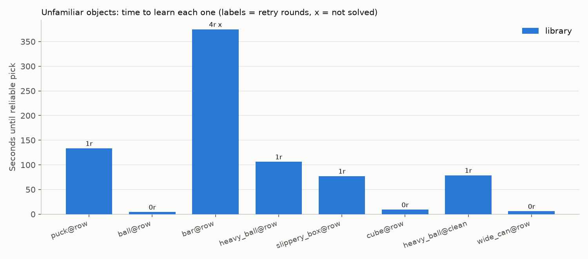

# Robot learning loop (simulation)

**Run → Capture → Find the failure → Fix → Run again**, with Codex as the brain that fixes the robot.

A simulated Franka Panda in [MuJoCo](https://mujoco.org) picks up randomized cubes and places them on a target.
Every episode is recorded. Failures are detected and labelled automatically, and Codex reads the evidence
and proposes a fix. A regression gate on held-out seeds accepts the fix only if it really fails less.
Built as a starter for the Alloy Robotics × OpenAI Physical AI Hackathon (Sydney, 5 Dec 2026).



## Results

Both brains start from the same deliberately bad controller (v0) and are scored on the same 100 held-out seeds:



| Brain | Held-out success | What happened |
|---|---|---|
| v0 controller | 56% | Cubes slip during lift (heavy, low-friction cubes) and grasps miss (small or rotated cubes). |
| Heuristic rules | 56 → 80 → **88%** | Slowed the lift, then got stuck repeating a fix the gate had already rejected. |
| **Codex** | 56 → 96 → **97%** | Read `controller.py`, found yaw alignment and close-range re-measure, and explained the slip physics. The gate rejected its third, no-gain idea. |

97% matches the best hand-tuned settings for this controller. Each Codex call takes about 40 seconds.

What Codex sees for a failure: keyframes before, at and after a one-sided grasp, where only the left finger is touching.



## Unfamiliar objects: retry, reanalyze, remember

The arm then meets objects and scenes it has never seen: a puck, balls, cans, a slippery box and a bar, on a
clean floor or between a row of blocks. Their mass and friction are hidden from the brain. For each object:

1. **Try** with the best settings so far, 8 trials.
2. **Find the failure** and send Codex the report plus before/at/after keyframes.
3. Codex proposes **4 different fixes**, which run **at the same time** (4 × 8 = 32 simulations in about 3 s).
4. **Keep the best** and repeat until the arm picks the object up reliably, then confirm on 8 fresh trials.
5. **Save the success**: the settings and a video go into a success library. A similar object later starts from them.

Round 1 for the puck between blocks. Codex: *"the jaws sweep into those blocks"*, so one hypothesis turned the
grip 90° across the row. That one went to 100%, and the other three stayed at 0%:



Codex with the success library learned **7 of 8** unfamiliar tasks in about 13 minutes:



| Task | First try | Started from | Result |
|---|---|---|---|
| puck in a row | 0% | cube-trained settings | 100% after 1 round (rotate grip 90°) |
| ball in a row | **100%** | puck's saved success | no retry needed (4 s) |
| bar in a row | 25% | cube-trained settings | unsolved, best 38% after 4 rounds |
| heavy ball in a row | 0% | ball's saved success | 100% after 1 round (slower lift and carry) |
| slippery box in a row | 25% | ball's saved success | 100% after 1 round (let the grip settle, then lift slowly) |
| cube in a row | **100%** | saved success | no retry needed |
| heavy ball, clean floor | 62% | heavy ball's saved success | 100% after 1 round |
| wide can in a row | **100%** | saved success | no retry needed |

- **Time:** one retry round is about 1.5 minutes: Codex takes 57–220 s (median 90 s) to write 4 hypotheses from
  the report and 2 images, and the 32 simulations take about 3 s. A similar object already in the library takes 4–9 s.
- **Without the library**, the rule-based brain solved 5/8 in 15 rounds, against 7/8 in 8 rounds with it.
- **The bar** can't be solved by changing settings. It needs a new grasp strategy, which is the next step:
  Codex edits the controller code itself.
- These tasks use MuJoCo's elliptic friction cone (`physics="realistic"`), because the default soft contacts let
  held objects slowly slide out of the fingers. The cube results above use the default physics.

```bash
uv run python scripts/novel_objects.py --brain heuristic --mode both        # offline, library vs from scratch
uv run python scripts/novel_objects.py --brain codex --mode library         # needs codex login
uv run python scripts/novel_objects.py --tasks puck@row ball@row --k 4 --trials 8
```
Output goes to `out/novel/<run_id>/`:

| File | What it is |
|---|---|
| `summary.md`, `time_to_learn.png` | rounds, simulations and seconds per task, for each mode |
| `<mode>/<task>/round_N.png` | the grid of hypotheses tested in round N (`round_0.png` is the first try) |
| `<mode>/<task>/round_N/brain/` | the report and keyframes Codex saw, and its raw answer |
| `<mode>/<task>/result.json` | every round's candidates, timings and the final settings |
| `library/library.json`, `library/<task>@<scene>/` | the saved successes, each with a video of a successful pick |

## Teammate quickstart

### 1. Install tools (once)
```bash
# uv (installs the right Python for you)
# Windows PowerShell:
powershell -ExecutionPolicy ByPass -c "irm https://astral.sh/uv/install.ps1 | iex"
# macOS / Linux:
curl -LsSf https://astral.sh/uv/install.sh | sh

# Optional, for the Codex brain (Node 18+):
npm i -g @openai/codex
codex login        # sign in with ChatGPT
```

### 2. Clone and set up
```bash
git clone https://github.com/kaiday/robot-learning-loop
cd robot-learning-loop
uv sync

# Robot models from MuJoCo Menagerie (not stored in this repo, ~100 MB)
git clone --depth 1 --filter=blob:none --sparse https://github.com/google-deepmind/mujoco_menagerie third_party/mujoco_menagerie
git -C third_party/mujoco_menagerie sparse-checkout set franka_emika_panda trs_so_arm100 unitree_go2
```

### 3. Check it works
```bash
uv run pytest -q                                   # expect: 23 passed (~75 s)
uv run python scripts/show_robots.py --view panda  # 3D window; also so_arm100, go2
uv run python scripts/show_robots.py               # PNG renders in out/robots/
```

### 4. Run the learning loop
```bash
uv run python -m rll.loop --brain heuristic --iters 4 --run-id my-heuristic   # offline, ~5 min
uv run python -m rll.loop --brain codex --iters 4 --run-id my-codex           # needs codex login
uv run python scripts/compare_runs.py my-heuristic my-codex                    # writes out/compare.png
```
Options: `--train N` sets the training episodes per iteration (default 60), `--eval N` sets the held-out
episodes for the gate (default 100), and `--promote` writes the final params back to `policy/params.json`.

Each run writes `out/runs/<run_id>/`:

| File | What it is |
|---|---|
| `history.json`, `success_curve.png` | held-out success per iteration |
| `iter_NN/report.md` | failure types, phases, and which conditions drive them |
| `iter_NN/failures/ep_*/` | replayed failure: `steps.parquet`, `video.mp4`, `keyframes.png`, `meta.json` |
| `iter_NN/brain/` | exactly what the brain was given, plus Codex's raw answer and log |
| `iter_NN/proposal.json` | the diagnosis and proposed changes |
| `iter_NN/gate.json` | accept/reject, with fixed and regressed counts |
| `params_vN.json` | each accepted version |

## How it works

| Loop step | Code |
|---|---|
| **Run** | `rll/env.py`: seeded randomization of cube pose, size, mass, friction and camera noise. `policy/controller.py` is a scripted controller driven by `policy/params.json`. |
| **Capture** | `rll/runner.py` logs every control step: poses, finger contacts, gripper and phase. `rll/replay.py` replays a seed bit-exactly and saves video. |
| **Find the failure** | `rll/detect.py` labels the failure (knocked, missed_grasp, slip, misplaced or timeout) with its step and phase. `rll/analyze.py` reports the failure rate per tercile of each condition. |
| **Fix** | `rll/brains.py`: `CodexBrain` runs `codex exec -s read-only --output-schema …` and remembers which earlier tries were accepted or rejected. `HeuristicBrain` is the offline fallback. |
| **Run again** | `rll/gate.py` runs 100 held-out seeds and accepts only a gain with at most 3% regressions. |
| **Unfamiliar objects** | `rll/objects.py` (catalogue and scenes), `rll/adapt.py` (retry rounds with parallel hypotheses), `rll/library.py` (success library matched on shape, width and height), `rll/visual.py` (round grids). |
| **Store** | `rll/storage.py` sends results to the Cloudflare Worker in `cloud/`: files go to R2, the iteration index to D1, and a dashboard is served at `/`. |

Codex runs read-only. It proposes changes, every value is clamped to `PARAM_BOUNDS`, and the gate decides.

## Cloudflare storage (optional)

Run it locally with simulated R2 and D1:
```bash
cd cloud && npm i
npx wrangler d1 migrations apply rll --local
npx wrangler dev --local                  # dashboard: http://127.0.0.1:8787
```
In a second terminal, from the repo root:
```bash
# bash / macOS / Linux
RLL_WORKER_URL=http://127.0.0.1:8787 uv run python -m rll.loop --iters 2
```
```powershell
# Windows PowerShell
$env:RLL_WORKER_URL = "http://127.0.0.1:8787"; uv run python -m rll.loop --iters 2
```

Deploy to your Cloudflare account:
```bash
npx wrangler login
npx wrangler r2 bucket create robot-learning-runs
npx wrangler d1 create rll                # paste the database_id into wrangler.jsonc
npx wrangler d1 migrations apply rll --remote
npx wrangler secret put API_TOKEN
npx wrangler deploy
```
Then set `RLL_WORKER_URL` to the deployed URL and `RLL_WORKER_TOKEN` to your API token.

## Troubleshooting

| Problem | Fix |
|---|---|
| `codex exec failed (…)` | Run `codex login` again, and check `iter_NN/brain/codex_stdout.log`. `--brain heuristic` works without Codex. |
| `You've hit your usage limit` | The ChatGPT plan's Codex allowance is used up. Log in with an API key instead (`codex login --with-api-key`), or use `--brain heuristic`. The unfamiliar-objects run stops cleanly and keeps finished tasks. |
| Rendering errors on a Linux server with no display | `export MUJOCO_GL=egl` (or `osmesa`) before running. |
| `--view` on macOS | Works with `uv run`. Use `mjpython` only if you switch to MuJoCo's non-blocking (passive) viewer. |
| `Error opening file …mujoco_menagerie…` | You skipped the robot models step in setup. |
| Loop is slow | It uses one process per CPU core minus two. Try lowering `--train` and `--eval`. |
| `WARNING: Nan, Inf … unstable` | Only appears if you edit cube mass without calling `mujoco.mj_setConst`; see `rll/env.py`. |
